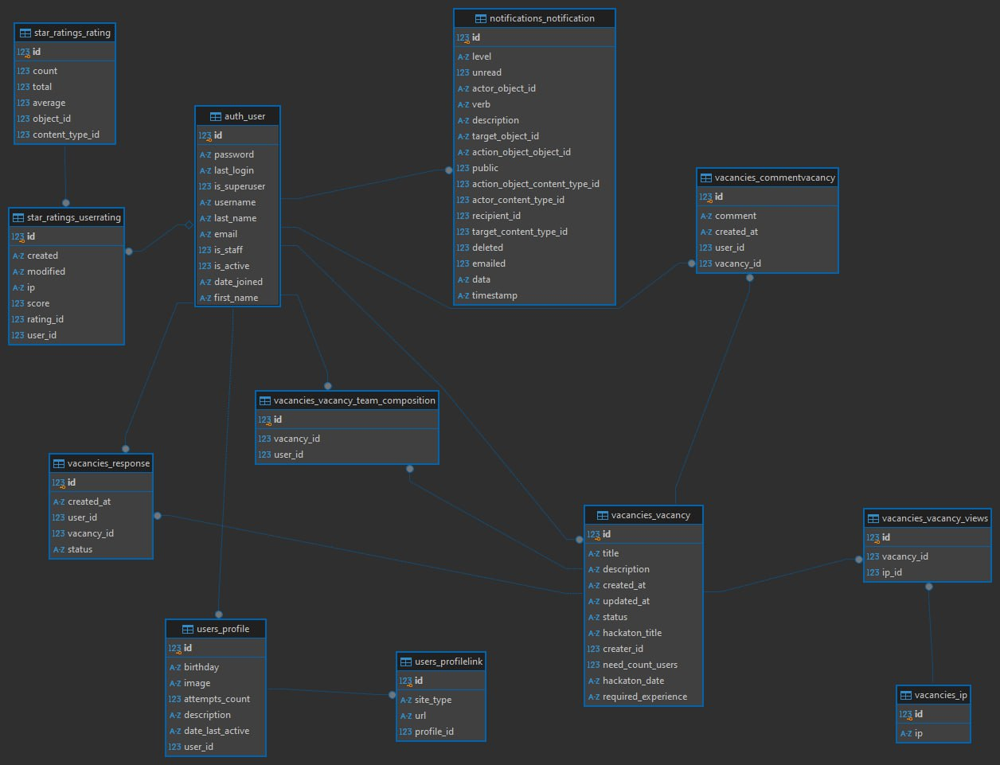

# HackMate


## Удобный сервис по поиску сокомандников для хакатонов

---

## 📖 Содержание
- [Введение](#введение)
  - [Возможности HackMate](#возможности-hackmate)
- [Структура проекта](#структура-проекта)
  - [Стек технологий](#стек-технологий)
  - [База данных](#база-данных)
- [Установка](#инструкция-по-запуску)
  - [Клонирование репозитория](#клонирование-репозитория)
  - [Создание виртуальной среды](#создание-виртуальной-среды)
  - [Активация окружения](#активация-окружения)
  - [Установка зависимостей](#установка-зависимостей)
  - [Настройка переменных окружения](#настройка-переменных-окружения)
- [Миграции базы данных](#миграции-базы-данных)
- [Фикстуры](#фикстуры)
- [ER-диаграмма](#er-диаграмма)
- [Интернационализация](#интернационализация)
- [Тестирование](#тестирование)
- [Авторы](#авторы)

---

## Введение
HackMate предоставляет простой и удобный инструмент для поиска сокомандников для хакатонов, чтобы собрать идеальную команду для реализации ваших идей.

### Возможности HackMate
С помощью HackMate вы можете:
- Искать участников по навыкам.
- Формировать команду в несколько кликов.
- Управлять проектами и взаимодействием участников.
- Смотреть историю участия.


---

##  Структура проекта

### Стек технологий
- [Python](https://www.python.org/) ([Django](https://www.djangoproject.com/)) - 3.12 и 4.2 - золотой набор)
- [Django-star-ratings](https://django-star-ratings.readthedocs.io/en/latest/) - чтоб пользователи могли ставить звездочки и оценивать друг друга
- HTML, CSS, JavaScript - для красивой картинки и всяческих динамических изменений)
- [PostgresSQL](https://www.postgresql.org/) - удобная и эффективная бд

### База данных
Проект использует реляционную базу данных PostgresSQL. Детали можно найти в разделе [ER-диаграмма](#er-диаграмма).

---
## Установка
### Инструкция по запуску с помощью docker-compose
Есть два режима `prod` и `dev` (порты отличаются, сделано для возможности развернуть `dev` не сворачивая `prod`)
* для запуска `prod`
```bash
docker-compose --profile prod up -d --build #порт 8080
```
* для запуска `dev`
```bash
docker-compose --profile dev up -d --build #порт 80
```

Если вдруг Вы хотите остановить (или вообще удалить) контейнер
```bash
docker-compose down --profile {имя контейнера}     # Остановить и удалить
docker-compose down -v                             # + удалить volumes
docker-compose down --rmi all                      # + удалить образы
```


###  Инструкция по запуску (для тех, кто любит все делать своими руками)
-подразумевает загрузку всего необходимого ПО непосредственно на локальную
  машину, с последующей ручной установкой и настройкой каждого компонента.
  Долгий и трудный путь, зато вы имеете полный контроль над всем происходящим

### Клонирование репозитория
Клонируйте проект с помощью команды:
```bash
git clone https://github.com/ShelMakar/HackMate.git
```

### Создание виртуальной среды
#### Windows
```cmd
python -m venv venv
```
#### Linux
```bash
sudo apt install python3-venv
python3 -m venv venv
```

### Активация окружения
#### Windows
```cmd
venv\Scripts\activate
```
#### Linux
```bash
source ./venv/bin/activate
```

### Установка зависимостей
- Для продакшн-окружения:
  ```bash
  pip install -r ./requirements/prod.txt
  ```
- Для разработки:
  ```bash
  pip install -r ./requirements/dev.txt
  ```
- Для тестирования:
  ```bash
  pip install -r ./requirements/test.txt
  ```

### Настройка переменных окружения
Перенесите переменные из `.env.template` в `.env`:
```bash
dump-env --template=.env.template --prefix='SECRET_ENV_' > .env
```
Проверьте кодировку .env файла!

## Важно!
Чтобы регистрация работала корректно, выполните действия описаные в [документации](https://yandex.ru/support/yandex-360/customers/mail/ru/mail-clients/others.html)

---

Перейдите в каталог `hackmate`:
```bash
cd hackmate
```
---


##  Миграции базы данных
Проект использует систему миграций для управления изменениями структуры базы данных.

- Создание миграции:
  ```bash
  python manage.py makemigrations
  ```
- Применение миграции:
  ```bash
  python manage.py migrate
  ```

---

##  Фикстуры
Фикстуры помогают загружать и выгружать данные базы данных.

- Загрузка фикстур:
  ```bash
  python manage.py loaddata fixtures/data.json
  ```
- Выгрузка фикстур:
  ```bash
  python -X utf8 manage.py dumpdata --indent 2  your_app > fixtures/data.json
  ```

---

##  ER-диаграмма

---

##  Интернационализация
Этот проект поддерживает интернационализацию.

### Создание собственной локализации
1. Добавьте язык в `settings.py`:
   ```python
   LANGUAGES = [
       ("ru", django.utils.translation.gettext_lazy("Русский")),
       ("en", django.utils.translation.gettext_lazy("English")),
       ("lang", django.utils.translation.gettext_lazy("Your_language")),
   ]
   ```
2. Создайте конфигурацию локализации:
   ```bash
   django-admin makemessages -l your_lang
   ```
3. Заполните содержимое файла локализации.
4. Компилируйте переводы:
   ```bash
   django-admin compilemessages
   ```

Подробнее о локализации можно прочитать [здесь](https://habr.com/ru/companies/ruvds/articles/498452/).

---
##  Тестирование
Запустите тесты:
   ```bash
   python manage.py test
   ```
---

## Создание суперпользователя
1. Чтобы создать суперпользователя введите команду
   ```bash
    python manage.py createsuperuser
   ```
2. Cледуйте инструкциям в терминале
---

## Запуск приложения
Перейдите в каталог `hackmate` и выполните:
```bash
python manage.py runserver
```
---


##  Автор
- **Шеляг Макар**  
  [GitHub](https://github.com/ShelMakar) | [Telegram](https://t.me/shel_makar)
